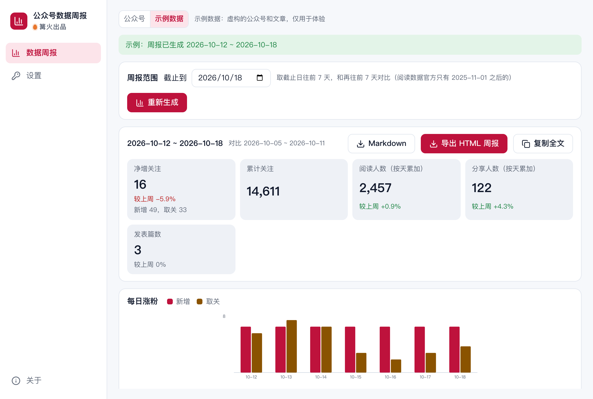

# 公众号数据周报

> 篝火出品 · 收录于篝火 App 应用区

官方数据接口，自动出阅读、涨粉图表



## 下载

到 [Releases](https://github.com/campfire-code/mp-weekly-report/releases/latest) 下载对应安装包：

| 电脑 | 文件 |
|---|---|
| Windows 10 / 11 | `mp-weekly-report_版本号_windows-x64-setup.exe` |
| Mac（Apple 芯片） | `mp-weekly-report_版本号_mac-arm64.dmg` |
| Mac（Intel 芯片） | `mp-weekly-report_版本号_mac-x64.dmg` |

第一次打开：
- **Windows**：如果弹出「Windows 已保护你的电脑」，点「更多信息」→「仍要运行」。
- **Mac**：如果提示「无法验证开发者」，打开「系统设置 → 隐私与安全性」，在下方点「仍要打开」。

## 怎么用

先决条件（接口要求，核对自微信开发者文档 developers.weixin.qq.com「数据统计」各接口页）：

1. 公众号必须是**已认证**的公众号或服务号。官方文档写明这些数据接口「仅认证」，未认证账号会返回没有权限（错误码 48001）。
2. 到「微信开发者平台（developers.weixin.qq.com/platform）→ 我的业务 → 选择这个公众号 → 开发密钥」复制 **AppID**，生成并复制 **AppSecret**（只显示一次）。
3. 在同一页的「**API IP 白名单**」里加入本机所在网络的公网出口 IP（固定 IP），否则报错误码 40164。动态 IP 变化后需要重新填写。
4. 数据每天**早上 8 点后**才有前一天的数据；北京时间 8 点前，工具默认的截止日期是前天。

操作：

1. 打开工具，在「公众号设置」里填 AppID 和 AppSecret，点「保存并测试连接」（会换取 access_token 并试取一天的累计关注数据，用来确认权限）。二者只保存在本机设置里，不会上传，也不会写进日志。没有认证公众号可以先切到「示例数据」体验。
2. 在「周报范围」选**截止日期**（默认昨天；最晚是昨天），点「生成周报」。工具取截止日往前 7 天（本周）和再往前 7 天（上周）：
   - 用户增减、累计关注：getusersummary / getusercumulate（官方每次最多 7 天）；
   - 阅读概况（阅读、分享、在看、点赞、留言、收藏、发表篇数及阅读来源）：getbizsummary（每次最多 30 天，数据从 2025-11-01 起）；
   - 本周发表的每篇文章明细：getarticletotaldetail（每次只能查 1 天，每篇只统计发表后 30 天）。
3. 周报包含：核心指标卡片（带较上周的环比）、每日涨粉柱状图、累计关注折线、关注渠道表、每日阅读人数折线、阅读来源、本周文章表（按阅读人数排序）。某一部分取数失败时，其余部分照常显示，页面底部写明失败原因。
4. 可选：点「让 AI 解读」。大模型接口、密钥、模型名在本工具的「设置」页自己填（兼容 OpenAI 接口格式）。只会发送汇总数字和文章标题，不发 AppID、AppSecret、文章链接。
5. 点「导出 HTML 周报」得到一个离线可看的单文件网页（可直接发给同事），或「Markdown」、「复制全文」。文件保存在「下载/公众号数据周报」文件夹。

**说明与限制**：
- 阅读人数、分享人数的周合计是**每天的人数相加**，同一个人在不同天阅读会重复计算，页面和导出里都有标注。
- 本周内发表的文章，指标是发表日到最近统计日的累计，不是单日值。
- 官方旧接口 getarticlesummary / getarticletotal 已标注停止维护，本工具用的是官方推荐的替代接口，所以阅读类数据只有 2025-11-01 之后的；更早的周只出涨粉部分。
- 本工具不保存历史数据；官方建议自行保存数据，需要留档请导出 HTML / Markdown。
- **未核实**：数据接口的每日调用次数上限，官方接口页没有写明；本工具生成一份周报约调用 5～12 次。access_token 获取接口（/cgi-bin/token）的参数沿用已核对过的写法。本工具没有用真实认证公众号测试过，接口格式按官方文档字段名和测试里的应答样例验证。

## 验收用例

以下全部用「示例数据」完成，不需要公众号，也不联网：

1. 打开工具，顶部选「示例数据」，保持默认截止日期，点「生成周报」。应提示「周报已生成：开始日 ~ 截止日」（共 7 天），出现 4～5 张指标卡片（净增关注、累计关注、阅读人数、分享人数、发表篇数），涨粉柱状图 7 组柱，阅读折线 7 个点。
2. 看「本周发表的文章」：只有每周二、周五、周日发表的示例文章，标题都以「示例：」开头，按阅读人数从高到低排列。
3. 把截止日期改成 `2025-11-05` 再生成：涨粉部分正常显示，页面底部提示「阅读数据没有取到：官方的阅读数据接口只有 2025-11-01 之后的数据」。
4. 点「导出 HTML 周报」，用浏览器打开导出的文件：应是单个网页，含指标卡片、两张图、文章表，断网也能看；点「Markdown」得到 .md 文件，表格列与页面一致。
5. 点「复制全文」后粘贴到任意文本框，应得到以「# 公众号数据周报」开头的 Markdown。
6. 配置好大模型后点「让 AI 解读」，应出现 3 段解读文字；没配置时按钮不可点并有红字提示去「设置」页。
7. 真实公众号验收：按「怎么用」完成设置，切到「公众号」点「保存并测试连接」应提示「连接成功」；AppSecret 填错应提示「AppSecret 不对」；没加 IP 白名单应提示加入 API IP 白名单（含微信看到的 IP）；未认证账号应提示「没有调用该接口的权限…仅开放给已认证」。

## 自己编译

需要 Node.js 22、pnpm、Rust。

```bash
pnpm install
pnpm test          # 单元测试
pnpm tauri dev     # 开发运行
pnpm tauri build   # 打包
```

界面框架在 `src/kit`（所有 campfire-code 工具共用），本工具的逻辑在 `src/tool`。

## 归属

本工具由**篝火**出品，是篝火 App 应用区收录的开源工具之一，由篝火（GitHub 组织 [campfire-code](https://github.com/campfire-code)）维护与更新。全部工具的目录见 [toolkit-hub](https://github.com/campfire-code/toolkit-hub)。

## 许可证

MIT，版权方为篝火（campfire-code）。
